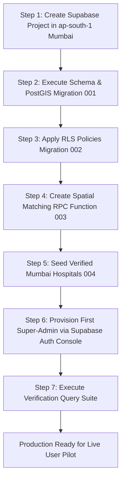

# Blood_Link — Production Data Migration & Pilot Seeding Plan

**Target Infrastructure:** Supabase Managed PostgreSQL + PostGIS (Mumbai `ap-south-1`)  
**Target Region:** Mumbai Metropolitan Pilot (Mumbai City & Mumbai Suburban)  
**Document Status:** Data Migration & Seeding Plan (Phase 0.2)  
**Execution Constraint:** Planning Only — No code changes or database alterations until explicit approval.

---

## 1. Zero-Contamination Principle (Production Isolation)

A fundamental requirement for launching a genuine, life-critical healthcare coordination platform is **absolute isolation** between development test data and live production storage.

```
       [ LOCAL / DEV ENVIRONMENT ]                 [ PRODUCTION ENVIRONMENT ]
    ┌────────────────────────────────┐          ┌────────────────────────────────┐
    │ - SQLite WebAssembly (sql.js)  │          │ - Supabase Managed PostgreSQL  │
    │ - Simulated OTP (Development)  │   STRICT │ - Supabase Auth (GoTrue)       │
    │ - Mock Donors (John, Rahul...) │  BARRIER │ - Zero Fake Donors             │
    │ - Mock Emergency Requests      │ ════════>│ - Zero Mock Requests           │
    │ - In-Memory Haversine Math     │          │ - Only Verified Pilot Directory│
    │ - Demo Banner & Role Switcher  │          │ - Real PostGIS Spatial Indices │
    └────────────────────────────────┘          └────────────────────────────────┘
                 ▲                                               ▲
                 │                                               │
      `npm run dev`                                 Vercel Production Deployment
      (Development only)                            (Real users only)
```

### Safety Guarantees:
1. **Zero Seeded Accounts in Production**: The production database will start with **0 users, 0 donor profiles, 0 blood requests, and 0 donor matches**.
2. **Environment Variable Guard**: The automated seed script (`seed.ts` / `seed.sql`) will have a hard guard checking `process.env.NODE_ENV !== 'production'`. If connected to a production Supabase instance, any attempt to run mock data generation will immediately throw an error and abort.
3. **Dedicated Pilot Directory**: The only initial data pre-populated into production will be **verified, licensed hospitals and blood banks in Mumbai** to ensure requesters can accurately select admission facilities.

---

## 2. Schema Initialization & Version-Controlled Migrations

All schema changes for production are managed as discrete, forward-only SQL migration files stored in version control (`supabase/migrations/`).

### Migration Sequence:
1. `001_initial_schema.sql`:
   - Enables `uuid-ossp`, `pgcrypto`, and `postgis`.
   - Creates enum types: `blood_group_enum`, `blood_component_enum`, `urgency_level_enum`, `request_status_enum`, `match_status_enum`, `user_role_enum`.
   - Creates core tables: `profiles`, `donor_profiles`, `health_questionnaires`, `locations`, `blood_requests`, `donor_matches`, `notifications`, `hospitals`, `admin_audit_logs`.
   - Creates spatial GIST index on `locations.geom` and B-Tree indexes on search keys.
2. `002_rls_policies.sql`:
   - Enables Row Level Security on all 9 public tables.
   - Defines read, insert, update, and delete access rules matching the security matrix in `SUPABASE_SETUP_GUIDE.md`.
3. `003_postgis_matching_function.sql`:
   - Creates the `match_potential_donors(...)` security-definer function for performant, coordinate-masked distance matching.
4. `004_verified_mumbai_hospitals.sql`:
   - Seeds only verified, accredited Mumbai hospitals and government/licensed blood banks.

---

## 3. Verified Mumbai Pilot Hospital Directory

To provide immediate utility without fabricating records, the production database will be pre-loaded with **10 prominent, licensed hospitals and government blood centres in Mumbai** across Mumbai City and Mumbai Suburban.

### Pilot Hospital Data Set:

```sql
-- Migration 004_verified_mumbai_hospitals.sql
INSERT INTO public.hospitals (
    id, 
    name, 
    district, 
    locality, 
    address, 
    contact_phone, 
    contact_email, 
    has_blood_bank, 
    is_verified, 
    latitude, 
    longitude, 
    geom
) VALUES 
-- 1. KEM Hospital & Seth GS Medical College (Parel, Mumbai City)
(
    gen_random_uuid(),
    'King Edward Memorial (KEM) Hospital',
    'Mumbai City',
    'Parel',
    'Acharya Donde Marg, Parel, Mumbai, Maharashtra 400012',
    '+91-22-2410-7000',
    'kemhospital@mcgm.gov.in',
    TRUE,
    TRUE,
    19.0028,
    72.8427,
    ST_SetSRID(ST_MakePoint(72.8427, 19.0028), 4326)::geography
),

-- 2. Tata Memorial Hospital (Parel, Mumbai City)
(
    gen_random_uuid(),
    'Tata Memorial Hospital (Advanced Centre for Oncology)',
    'Mumbai City',
    'Parel',
    'Dr. E Borges Road, Parel, Mumbai, Maharashtra 400012',
    '+91-22-2417-7000',
    'tmhbloodbank@tmc.gov.in',
    TRUE,
    TRUE,
    19.0051,
    72.8432,
    ST_SetSRID(ST_MakePoint(72.8432, 19.0051), 4326)::geography
),

-- 3. Lilavati Hospital & Research Centre (Bandra West, Mumbai Suburban)
(
    gen_random_uuid(),
    'Lilavati Hospital and Research Centre',
    'Mumbai Suburban',
    'Bandra West',
    'A-791, Bandra Reclamation Rd, Bandra West, Mumbai, Maharashtra 400050',
    '+91-22-2675-1000',
    'info@lilavatihospital.com',
    TRUE,
    TRUE,
    19.0511,
    72.8290,
    ST_SetSRID(ST_MakePoint(72.8290, 19.0511), 4326)::geography
),

-- 4. Kokilaben Dhirubhai Ambani Hospital (Andheri West, Mumbai Suburban)
(
    gen_random_uuid(),
    'Kokilaben Dhirubhai Ambani Hospital',
    'Mumbai Suburban',
    'Andheri West',
    'Rao Saheb, Achutrao Patwardhan Marg, Four Bungalows, Andheri West, Mumbai 400053',
    '+91-22-4269-6969',
    'bloodbank@kdah.com',
    TRUE,
    TRUE,
    19.1312,
    72.8251,
    ST_SetSRID(ST_MakePoint(72.8251, 19.1312), 4326)::geography
),

-- 5. P.D. Hinduja National Hospital (Mahim, Mumbai City)
(
    gen_random_uuid(),
    'P. D. Hinduja Hospital & Medical Research Centre',
    'Mumbai City',
    'Mahim',
    'Veer Savarkar Marg, Mahim West, Mumbai, Maharashtra 400016',
    '+91-22-2445-1515',
    'bloodbank@hindujahospital.com',
    TRUE,
    TRUE,
    19.0330,
    72.8397,
    ST_SetSRID(ST_MakePoint(72.8397, 19.0330), 4326)::geography
),

-- 6. Bombay Hospital & Medical Research Centre (Marine Lines, Mumbai City)
(
    gen_random_uuid(),
    'Bombay Hospital and Medical Research Centre',
    'Mumbai City',
    'Marine Lines',
    '12, Vitthaldas Thackersey Marg, New Marine Lines, Marine Lines, Mumbai 400020',
    '+91-22-2206-7676',
    'helpdesk@bombayhospital.com',
    TRUE,
    TRUE,
    18.9392,
    72.8288,
    ST_SetSRID(ST_MakePoint(72.8288, 18.9392), 4326)::geography
),

-- 7. Lokmanya Tilak Municipal General Hospital (Sion Hospital, Mumbai City)
(
    gen_random_uuid(),
    'Lokmanya Tilak Municipal General Hospital (Sion Hospital)',
    'Mumbai City',
    'Sion',
    'Sion West, Mumbai, Maharashtra 400022',
    '+91-22-2407-6381',
    'ltmgh@mcgm.gov.in',
    TRUE,
    TRUE,
    19.0368,
    72.8601,
    ST_SetSRID(ST_MakePoint(72.8601, 19.0368), 4326)::geography
),

-- 8. Dr. R. N. Cooper Municipal General Hospital (Juhu, Mumbai Suburban)
(
    gen_random_uuid(),
    'Dr. R. N. Cooper Municipal General Hospital',
    'Mumbai Suburban',
    'Juhu / Vile Parle',
    'U 15, Bhaktivedanta Swami Marg, J.P.D.C. Scheme, Vile Parle West, Mumbai 400056',
    '+91-22-2620-7254',
    'cooperhospital@mcgm.gov.in',
    TRUE,
    TRUE,
    19.1065,
    72.8362,
    ST_SetSRID(ST_MakePoint(72.8362, 19.1065), 4326)::geography
),

-- 9. Dr. Balabhai Nanavati Max Super Speciality Hospital (Vile Parle West, Mumbai Suburban)
(
    gen_random_uuid(),
    'Nanavati Max Super Speciality Hospital',
    'Mumbai Suburban',
    'Vile Parle West',
    'Swami Vivekananda Rd, Besant Montessori School, Vile Parle West, Mumbai 400056',
    '+91-22-2626-7500',
    'bloodbank@nanavatihospital.org',
    TRUE,
    TRUE,
    19.0967,
    72.8407,
    ST_SetSRID(ST_MakePoint(72.8407, 19.0967), 4326)::geography
),

-- 10. Dr. L H Hiranandani Hospital (Powai, Mumbai Suburban)
(
    gen_random_uuid(),
    'Dr. L H Hiranandani Hospital',
    'Mumbai Suburban',
    'Powai',
    'Hillside Avenue, Hiranandani Gardens, Powai, Mumbai, Maharashtra 400076',
    '+91-22-2576-3300',
    'wecare@hiranandanihospital.org',
    TRUE,
    TRUE,
    19.1197,
    72.9126,
    ST_SetSRID(ST_MakePoint(72.9126, 19.1197), 4326)::geography
)
ON CONFLICT (id) DO NOTHING;
```

---

## 4. Migration Execution Steps (Step-by-Step)



### Step-by-Step Procedure:

1. **Step 1: Database Provisioning**:
   - Create project in Supabase under `ap-south-1` region.
   - Note database URI (Port 6543 pooler) and public Anon key.

2. **Step 2: Execute Schema & Extensions**:
   - Open Supabase SQL Editor.
   - Run `001_production_schema.sql` (from `SUPABASE_SETUP_GUIDE.md`).
   - Confirm PostGIS tables and spatial types exist:
     ```sql
     SELECT PostGIS_Version();
     ```

3. **Step 3: Enable Security & Policies**:
   - Run `002_rls_policies.sql`.
   - Verify all tables show `rls_enabled = true` in Supabase table editor.

4. **Step 4: Install Spatial Stored Procedure**:
   - Run `003_postgis_matching_function.sql`.
   - Test execution with dummy coordinates in Dadar (19.0178, 72.8478).

5. **Step 5: Seed Pilot Hospitals**:
   - Run `004_verified_mumbai_hospitals.sql`.
   - Confirm 10 rows inserted in `public.hospitals`.

6. **Step 6: Provision First System Administrator**:
   - Navigate to Supabase Dashboard $\to$ **Authentication** $\to$ **Users** $\to$ **Add User**.
   - Create an admin user with verified email.
   - Run administrative SQL to set profile role:
     ```sql
     UPDATE public.profiles 
     SET role = 'admin', is_verified = TRUE 
     WHERE email = 'your-admin-email@example.com';

     -- Also set JWT app_metadata for RLS enforcement
     UPDATE auth.users 
     SET raw_app_meta_data = raw_app_meta_data || '{"role": "admin"}'::jsonb 
     WHERE email = 'your-admin-email@example.com';
     ```

---

## 5. Verification & Pre-Pilot Smoke Test Suite

Before directing any live voluntary donors or patients to the URL, run the following verification queries in the Supabase SQL editor:

```sql
-- 1. Verify PostGIS Spatial Index is Active
SELECT indexname, indexdef 
FROM pg_indexes 
WHERE tablename = 'locations' AND indexname = 'idx_locations_geom';

-- 2. Verify Zero Contamination (All user tables must be empty)
SELECT 
    (SELECT COUNT(*) FROM public.profiles WHERE role != 'admin') AS live_users_count,
    (SELECT COUNT(*) FROM public.donor_profiles) AS live_donors_count,
    (SELECT COUNT(*) FROM public.blood_requests) AS live_requests_count,
    (SELECT COUNT(*) FROM public.donor_matches) AS live_matches_count,
    (SELECT COUNT(*) FROM public.hospitals WHERE is_verified = TRUE) AS verified_hospitals_count;
-- Expected Result:
-- live_users_count = 0
-- live_donors_count = 0
-- live_requests_count = 0
-- live_matches_count = 0
-- verified_hospitals_count = 10

-- 3. Test PostGIS Spatial Distance Between KEM Hospital (Parel) and Lilavati (Bandra)
SELECT 
    h1.name AS hospital_1,
    h2.name AS hospital_2,
    ROUND((ST_Distance(h1.geom, h2.geom) / 1000.0)::numeric, 2) AS distance_km
FROM public.hospitals h1, public.hospitals h2
WHERE h1.name LIKE '%KEM%' AND h2.name LIKE '%Lilavati%';
-- Expected Result: ~5.5 km to 5.7 km (Geodesic distance across Mumbai)
```

---

## 6. Backup, Disaster Recovery & Rollback Strategy

1. **Automated Supabase Backups**:
   - Daily automated WAL-based backups managed by Supabase.
   - Point-in-time recovery (PITR) available on Pro tier.
2. **Emergency Rollback Procedure**:
   - In the event of schema corruption or migration failure during initial setup, the clean rollback script drops the tables in reverse foreign key order:
     ```sql
     -- EMERGENCY SCHEMA RESET (Use ONLY before launch in staging/setup)
     DROP TABLE IF EXISTS public.donor_matches CASCADE;
     DROP TABLE IF EXISTS public.blood_requests CASCADE;
     DROP TABLE IF EXISTS public.health_questionnaires CASCADE;
     DROP TABLE IF EXISTS public.donor_profiles CASCADE;
     DROP TABLE IF EXISTS public.locations CASCADE;
     DROP TABLE IF EXISTS public.notifications CASCADE;
     DROP TABLE IF EXISTS public.admin_audit_logs CASCADE;
     DROP TABLE IF EXISTS public.hospitals CASCADE;
     DROP TABLE IF EXISTS public.profiles CASCADE;
     ```
3. **Data Export for Statutory Audits**:
   - Administrative SQL query available to export anonymized donor response and request fulfillment metrics for Maharashtra State Blood Transfusion Council (SBTC) compliance audits.
