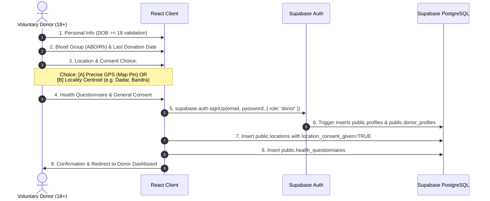

# Blood_Link — Master Production Migration Plan (Supabase + Vercel)
**Target Region:** Mumbai Metropolitan Pilot (Mumbai City & Mumbai Suburban, expandable to Thane, Navi Mumbai, and Maharashtra)  
**Document Status:** Architectural Planning Specification (Phase 0.2)  
**Execution Constraint:** Planning Only — No code changes or database alterations until explicit approval.

---

## 1. Existing Architecture Audit & Component Inventory

### 1.1 What Can Be Retained (Reusable Core)
- **Frontend Presentation Layer (`client/src/`)**:
  - UI components: `Navbar.tsx`, `Footer.tsx`, `PriorityBadge.tsx`, `StatusBadge.tsx`, `MedicalDisclaimer.tsx`.
  - Design system: Tailwind CSS palette (`#B91C32` primary red, `#1e2227` dark charcoal typography).
  - Page layouts: `LandingPage.tsx`, `AboutPage.tsx`, `HowItWorksPage.tsx`, `HospitalsPage.tsx`.
  - Dashboard templates: `DonorDashboard.tsx`, `RequesterDashboard.tsx`, `AdminDashboard.tsx`.
  - Client routing hierarchy in `App.tsx`.
- **Validation Schemas & Models**:
  - Zod schemas for donor registration, requester registration, and emergency requests (`authController.ts`, `requestController.ts`).
  - Domain TypeScript interfaces (`types/index.ts`).
- **Clinical & Business Domain Logic**:
  - Transfusion compatibility rules (ABO/Rh matrix and PRBC vs. Plasma inverted compatibility) in `matchingService.ts`.
  - Ranking score heuristics (Distance Score 0–60, Blood Match Score 15/30, Donation Rest Interval Score 2/10).
  - State machine lifecycle (`PENDING_VERIFICATION` $\to$ `VERIFIED` $\to$ `SEARCHING` $\to$ `DONOR_RESPONSES` $\to$ `COORDINATING` $\to$ `FULFILLED`).
- **Mathematical Distance Algorithm**:
  - Spherical Haversine calculation (`calculateHaversineDistanceKm`) as an offline/development fallback.

### 1.2 What Must Be Modified (Requires Adaptation)
- **Database Access Layer (`server/src/db/connection.ts`)**:
  - Replace dual-mode connection trying `pg.Pool` and falling back to `sql.js` (WebAssembly SQLite) with a production connection to Supabase PostgreSQL (via Supavisor connection pooling on port 6543 / transaction mode).
- **Geographical Distance Querying (`server/src/services/matchingService.ts`)**:
  - Replace in-memory Haversine loop over all active donors with a native PostGIS SQL query (`ST_DWithin` and `ST_Distance` on `geography(Point, 4326)`).
- **Authentication & Sessions (`client/src/context/AuthContext.tsx` & `server/src/middlewares/auth.ts`)**:
  - Upgrade custom JWT and bcrypt authentication to Supabase Auth (`@supabase/supabase-js`), linking `public.profiles` to `auth.users(id)`.
  - Maintain session state via Supabase Auth tokens with auto-refresh instead of unmanaged raw JWT in `localStorage`.
- **Location Storage & Consent (`client/src/pages/DonorRegisterPage.tsx` & `server/src/controllers/authController.ts`)**:
  - Introduce explicit geolocation consent fields (`location_consent_given`, `location_consent_timestamp`).
  - Allow donors to choose between `PRECISE_GPS` (pin on map) and `LOCALITY_CENTROID` (approximate locality center, e.g. Dadar or Andheri West).
- **Hospital Directory Management (`server/src/controllers/hospitalController.ts` & `adminController.ts`)**:
  - Add administrative CRUD operations (`POST`, `PATCH`, `DELETE`) to verify, edit, and audit hospital facilities and licensed blood centres.
- **Express Backend for Vercel Serverless Hosting (`server/src/index.ts`)**:
  - Adapt the long-running Express server into a Vercel-compatible serverless API handler (`api/index.ts`), ensuring connection pool reuse and stateless execution.

### 1.3 What Must Be Replaced or Removed in Production
- **Demo Banner & Shortcuts (`client/src/components/DemoBanner.tsx`)**:
  - Remove the 1-click role switcher banner (`quickLogin('admin')`, `quickLogin('donor')`, `quickLogin('requester')`) from production builds (`import.meta.env.PROD` guard).
- **Simulated OTP (`server/src/controllers/authController.ts`)**:
  - Replace development simulated OTP with real phone OTP or email confirmation via Supabase Auth / SMS provider.
- **Simulated Notification Metadata (`server/src/services/notificationService.ts`)**:
  - Remove console simulation tags (`smsSimulated: true`). In-app notifications remain fully functional; external SMS dispatch will only activate when verified SMS credentials are provided.
- **Seeded Mock Data (`server/src/db/seed.ts`)**:
  - Ensure mock data generation cannot execute against production databases. Isolate seed scripts exclusively to development environments.

---

## 2. Supabase Production Architecture

### 2.1 Database & PostGIS Foundation
- **Managed PostgreSQL (v15+)**: Hosted on Supabase (Mumbai Region `ap-south-1`).
- **Extensions**:
  - `postgis` (schema `extensions`): Enables native spatial geometries and spatial indexing.
  - `uuid-ossp` or `pgcrypto`: Enables UUID primary keys matching `auth.users.id`.
- **Spatial Data Types**:
  - Store entity locations using `geography(Point, 4326)`.
  - Add spatial GIST index: `CREATE INDEX idx_locations_geom ON locations USING GIST(geom);`.

### 2.2 Table Security & Row Level Security (RLS) Strategy
Every exposed table in the `public` schema will have Row Level Security enabled (`ALTER TABLE ... ENABLE ROW LEVEL SECURITY;`).

| Table Name | RLS Access Policy Strategy |
| :--- | :--- |
| **`public.profiles`** | - **Read**: Authenticated users can view their own profile. Authenticated requesters can view public donor profiles **only if** matched and accepted.<br>- **Update**: Users can update only their own profile (`auth.uid() = id`).<br>- **Insert**: Handled automatically via database trigger upon `auth.users` signup. |
| **`public.donor_profiles`** | - **Read/Update**: Donors can read and update only their own record (`auth.uid() = user_id`).<br>- **Admin**: Full administrative access for verified admin accounts. |
| **`public.health_questionnaires`** | - **Strict Isolation**: Donors can access only their own questionnaire (`auth.uid() = (SELECT user_id FROM donor_profiles WHERE id = donor_id)`).<br>- **No Public Read**: Requesters, matched patients, and non-admin users have **zero** access to health records. |
| **`public.locations`** | - **Read**: Donors/requesters can view their own locations.<br>- **Matching Function**: Spatial distance calculation executes within a `SECURITY DEFINER` function that never returns raw `(lat, lng)` coordinates, only computed `distance_km` and locality name. |
| **`public.blood_requests`** | - **Insert**: Authenticated requesters can create requests.<br>- **Read**: Requesters can view their own requests. Matched donors can view requests assigned to them. Admins can view all.<br>- **Update**: Requesters can cancel their own request. Admins can verify or reject. |
| **`public.donor_matches`** | - **Read**: Donors can view matches assigned to them (`donor_id = current_donor_id`). Requesters can view matches for their own requests.<br>- **Update**: Donors can update only their own match status (`status = 'ACCEPTED' \| 'DECLINED'`). |
| **`public.hospitals`** | - **Read**: Public read access for verified hospitals (`is_verified = TRUE`).<br>- **Write**: Restricted exclusively to administrators (`auth.jwt() ->> 'role' = 'admin'`). |
| **`public.admin_audit_logs`** | - **Write/Read**: Insert and select restricted strictly to verified administrators. No user updates or deletes allowed. |

### 2.3 Authentication Integration
- **Identity Provider**: Supabase Auth (GoTrue).
- **Identity Mapping**:
  - `auth.users.id` acts as the foreign key primary key for `public.profiles.id`.
  - User role (`donor`, `requester`, `admin`) is persisted in `public.profiles.role` and synced to `app_metadata` in `auth.users` to prevent client tampering.
- **Admin Provisioning**:
  - Public registration only allows `donor` or `requester`.
  - Admin roles are assigned only via the Supabase Dashboard, an administrative SQL command, or the privileged `service_role` key.

---

## 3. Real-World Data & Registration Workflows

### 3.1 Donor Registration Flow with Geolocation Consent


### 3.2 Privacy & Health Information Protection
1. **Coordinate Masking**: When patient attendants view potential donors, the database and API strictly mask exact residential coordinates. Attendants see only the donor's locality (e.g., *"Bandra West, 2.3 km away"*).
2. **Consent Revocation**: Donors can revoke their location consent at any time from their dashboard (`location_consent_given = FALSE`), which immediately removes them from future geospatial matching queries.
3. **Sensitive Health Data**: `health_questionnaires` are stored in an isolated table accessible only by the donor and designated clinical review administrators.

---

## 4. Mumbai Pilot Configuration

### 4.1 Geographic Pilot Scope
- **State**: Maharashtra (MH)
- **Initial Pilot Districts**:
  1. `Mumbai City` (South & Central Mumbai)
  2. `Mumbai Suburban` (Western & Eastern Suburbs)
- **Phase 2 Expansion Zones (No Schema Changes Required)**:
  - `Thane` (Thane City, Kalyan, Dombivli, Mira-Bhayandar, Navi Mumbai North)
  - `Raigad` (Navi Mumbai South: Vashi, Nerul, Belapur, Kharghar, Panvel)

### 4.2 Cross-Boundary PostGIS Matching
Because emergency cases in Mumbai frequently cross administrative borders (e.g., patient in Parel [Mumbai City] needing donor from Bandra [Mumbai Suburban] or Chembur), **the matching engine will not apply administrative district filters**. It relies strictly on ellipsoidal PostGIS distance:
- **Tier 1 (0 – 5 km)**: Immediate urban transit (15–20 minutes).
- **Tier 2 (5 – 10 km)**: Suburban transit radius.
- **Tier 3 (10 – 25 km)**: Extended metropolitan radius for rare blood types (O-, AB-, Bombay phenotype).

### 4.3 Verified Mumbai Hospital Directory
The hospital directory will be initialized with prominent, licensed Mumbai healthcare institutions. All records will carry an `is_verified` flag, and only administrators will have permission to verify or update hospital records:
- **Tata Memorial Hospital Blood Bank** (Parel, Mumbai City) — `19.0044, 72.8432`
- **KEM Hospital Blood Centre** (Parel, Mumbai City) — `19.0026, 72.8427`
- **Lilavati Hospital Blood Centre** (Bandra West, Mumbai Suburban) — `19.0514, 72.8290`
- **Kokilaben Dhirubhai Ambani Hospital** (Andheri West, Mumbai Suburban) — `19.1314, 72.8252`
- **P. D. Hinduja National Hospital** (Mahim, Mumbai City) — `19.0330, 72.8384`
- **Bombay Hospital & Medical Research Centre** (Marine Lines, Mumbai City) — `18.9406, 72.8286`
- **Dr. L H Hiranandani Hospital** (Powai, Mumbai Suburban) — `19.1197, 72.9113`
- **Nanavati Max Super Speciality Hospital** (Vile Parle West, Mumbai Suburban) — `19.0968, 72.8415`
- **Lokmanya Tilak Municipal General Hospital (Sion)** (Sion, Mumbai City) — `19.0366, 72.8601`
- **R. N. Cooper Municipal General Hospital** (Juhu, Mumbai Suburban) — `19.1082, 72.8361`

---

## 5. Implementation Roadmap (Phases 1 to 8)

| Phase | Core Objective | Files Affected | Dependencies & Prerequisites | Key Risks & Mitigations |
| :--- | :--- | :--- | :--- | :--- |
| **Phase 1** | Supabase Project & PostGIS Foundation | `supabase/migrations/001_initial_schema.sql`, `server/src/db/connection.ts` | Supabase Project created (`ap-south-1` Mumbai) | Risk: Syntax mismatch with PostGIS. Mitigation: Test SQL migration scripts in Supabase SQL Editor. |
| **Phase 2** | Supabase Auth & Secure Roles | `client/src/context/AuthContext.tsx`, `client/src/lib/supabase.ts`, `server/src/middlewares/auth.ts` | Phase 1 schema, `@supabase/supabase-js` | Risk: Session expiration issues. Mitigation: Use Supabase auto-refresh token handling. |
| **Phase 3** | Real Registration & Geolocation Consent | `client/src/pages/DonorRegisterPage.tsx`, `client/src/pages/RequesterRegisterPage.tsx`, `client/src/config/geography.ts` | Phase 2 Auth | Risk: Precision privacy leak. Mitigation: Implement locality centroid option for donors. |
| **Phase 4** | Serverless API Migration for Vercel | `api/index.ts`, `vercel.json`, `client/vite.config.ts` | Node.js `@vercel/node` | Risk: Cold start latency. Mitigation: Lightweight imports, connection pooling via Supavisor. |
| **Phase 5** | PostGIS Matching Function | `server/src/services/matchingService.ts`, SQL RPC `match_potential_donors` | Phase 1 PostGIS | Risk: Boundary clipping. Mitigation: Pure coordinate radius filtering without district WHERE clauses. |
| **Phase 6** | Verified Hospital Management | `server/src/controllers/hospitalController.ts`, `client/src/pages/AdminDashboard.tsx` | Phase 1 schema | Risk: Unverified records. Mitigation: Restrict write access strictly to verified admin accounts. |
| **Phase 7** | Vercel Deployment Configuration | `vercel.json`, `package.json`, environment variables setup | Vercel Account & GitHub Repo | Risk: Environment variable leaks. Mitigation: Strictly audit client `VITE_` prefix vs server secrets. |
| **Phase 8** | End-to-End Pilot Testing (Mumbai) | `server/src/qa_test.ts`, live pilot validation | Phases 1–7 complete | Risk: False emergency alerts. Mitigation: Keep SMS alerts disabled during staging validation. |

---

## 6. Recommended Final Architecture

```
                                  +------------------------------------+
                                  |         PUBLIC USER BROWSER        |
                                  |    (React 18 SPA on Vercel CDN)    |
                                  +-----------------+------------------+
                                                    |
                         +--------------------------+--------------------------+
                         | HTTPS (Supabase Client)                             | HTTPS (API Requests)
                         v                                                     v
          +-----------------------------+                       +-----------------------------+
          |        SUPABASE AUTH        |                       |   VERCEL SERVERLESS API     |
          |  (Email/Pass, Sessions,     |                       |   (/api/* Node.js Handlers) |
          |   Managed Tokens, Phone)    |                       |   - Admin Verification      |
          +--------------+--------------+                       |   - Matching Dispatch       |
                         |                                      |   - Audit Logging           |
                         | Linked by auth.uid()                 +--------------+--------------+
                         v                                                     |
          +--------------------------------------------------------------------+--------------+
          |                       SUPABASE POSTGRESQL DATABASE                                |
          |  - Extensions: PostGIS (geography, ST_DWithin, ST_Distance, GIST Indexes)          |
          |  - Security: Row Level Security (RLS) enabled on all 13 tables                     |
          |  - Privacy: Coordinate Masking & Restricted Health Questionnaire Access           |
          |  - Connection: Supavisor Connection Pooling (Port 6543)                            |
          +-----------------------------------------------------------------------------------+
```

---

*This document is for architectural planning only. No code or database changes have been applied.*
