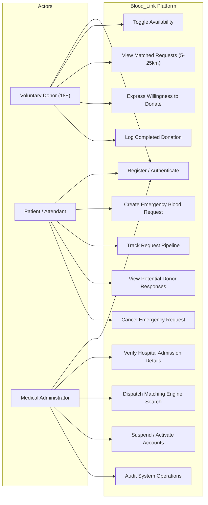
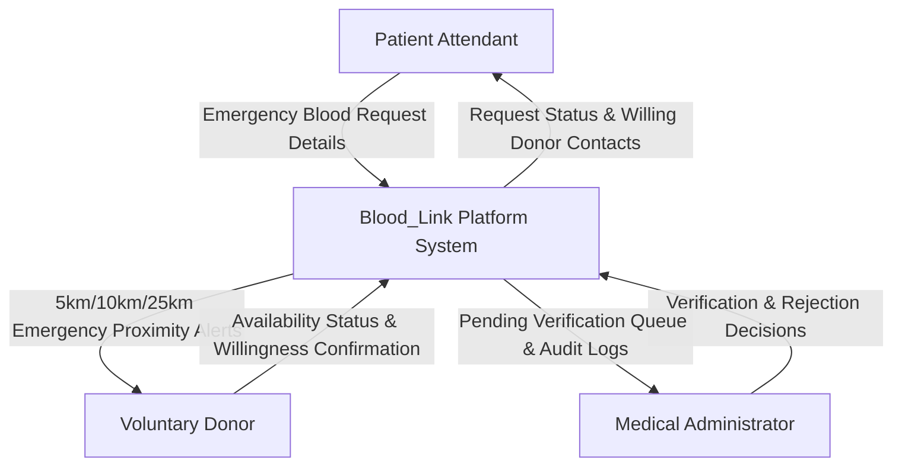
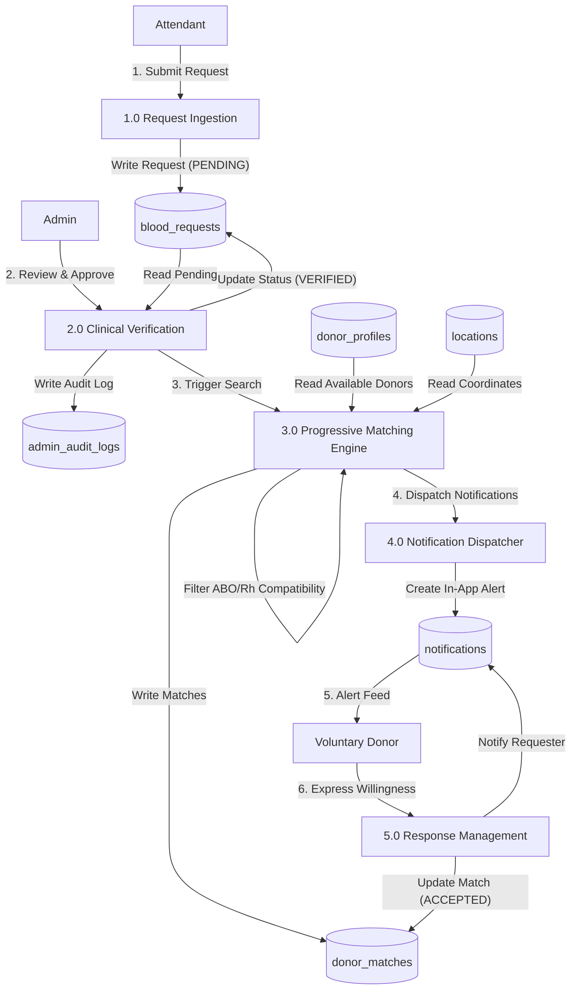

# Technical Architecture, Use-Case & Data Flow Specification — Blood_Link

---

## 1. Project Abstract & Objectives

### Abstract
**Blood_Link** is an emergency healthcare web platform designed to eliminate life-threatening delays in acute blood procurement. In critical clinical scenarios such as traumatic hemorrhages, elective surgeries, and dengue thrombocytopenia, patient attendants often resort to unverified broadcasts on social media that violate patient confidentiality and fail to prioritize nearby voluntary donors. Blood_Link provides a clinically supervised, privacy-preserving coordination layer that progressively matches available voluntary donors in **5 km, 10 km, and 25 km** perimeters.

### Objectives
1. **Minimize Response Latency**: Deliver emergency requests to the closest eligible voluntary donors within minutes.
2. **Eliminate False Alarms**: Enforce clinical administrative verification before dispatching emergency broadcast alerts.
3. **Respect Donor Autonomy & Health**: Provide instant availability toggles and track recommended rest periods (≥ 90 days).
4. **Ensure Regulatory Transparency**: Ground every transaction in the non-medical disclosure that clinical suitability, cross-matching, and viral safety testing must be conducted exclusively by authorized blood centre staff.

---

## 2. High-Level Modular Monolith Architecture

```
       +-------------------------------------------------------------+
       |                     REACT CLIENT (SPA)                      |
       |  React 18 + Vite + TypeScript + Tailwind CSS + Leaflet Maps |
       +------------------------------+------------------------------+
                                      | HTTP REST / JSON (JWT Auth)
                                      v
       +-------------------------------------------------------------+
       |                   NODE.JS / EXPRESS BACKEND                 |
       |  - Middlewares: Helmet, CORS, RateLimiter, JWT Auth Guard   |
       |  - Controllers: Auth, Donor, Requester, Request, Admin      |
       |  - Core Matching Engine (Haversine & PostGIS)               |
       |  - In-App & Simulated Notification Service                  |
       +------------------------------+------------------------------+
                                      | SQL Interface (Async Pool)
                                      v
       +-------------------------------------------------------------+
       |                   DUAL-MODE DATABASE LAYER                  |
       |  - Production: PostgreSQL + PostGIS (Production Target)     |
       |  - Local Dev Fallback: SQLite WebAssembly (Zero-Config)     |
       +-------------------------------------------------------------+
```

---

## 3. Use-Case Diagram & Role Descriptions



### Use-Case Descriptions
1. **UC-06 Create Emergency Request**: Attendant registers patient age, blood group, component, units, priority, and hospital facility. Status is initialized to `PENDING_VERIFICATION`.
2. **UC-10 Verify Hospital Admission Details**: Administrator contacts the hospital blood bank to confirm the doctor's prescription. Upon approval, status transitions to `VERIFIED`.
3. **UC-11 Dispatch Matching Engine Search**: The backend runs the Haversine distance algorithm against all active, available donors possessing compatible ABO/Rh types within 5km, 10km, and 25km. In-app notifications are dispatched to matched donors.
4. **UC-04 Express Willingness to Donate**: Donor confirms willingness to report to the blood bank. Status transitions to `DONOR_RESPONSES`. The patient attendant receives donor contact details.

---

## 4. Data-Flow Diagrams (DFD)

### 4.1 Level-0 Context Diagram (DFD Level 0)



### 4.2 Level-1 Detailed Data-Flow Diagram (DFD Level 1)



---

## 5. Core Progressive Matching Engine & Mathematical Proof

### 5.1 Compatibility Matrix
Human blood transfusion is governed by antigen-antibody interactions on erythrocyte membranes:
- **Red Cells (Whole Blood & PRBC)**:
  - **O-**: Universal Red Cell Donor (donates to O-, O+, A-, A+, B-, B+, AB-, AB+).
  - **O+**: Donates to O+, A+, B+, AB+.
  - **A-**: Donates to A-, A+, AB-, AB+.
  - **A+**: Donates to A+, AB+.
  - **B-**: Donates to B-, B+, AB-, AB+.
  - **B+**: Donates to B+, AB+.
  - **AB-**: Donates to AB-, AB+.
  - **AB+**: Universal Red Cell Recipient.
- **Plasma (FFP)**: Reverse compatibility rules apply (AB is the universal plasma donor).

### 5.2 Spherical Haversine Distance Calculation
Geospatial distances between hospital coordinates $(\phi_1, \lambda_1)$ and donor coordinates $(\phi_2, \lambda_2)$ are calculated via the spherical Haversine formula:

$$\Delta \phi = \phi_2 - \phi_1, \quad \Delta \lambda = \lambda_2 - \lambda_1$$

$$a = \sin^2\left(\frac{\Delta \phi}{2}\right) + \cos(\phi_1)\cos(\phi_2)\sin^2\left(\frac{\Delta \lambda}{2}\right)$$

$$c = 2 \cdot \operatorname{atan2}\left(\sqrt{a}, \sqrt{1 - a}\right)$$

$$d = R \cdot c \quad (R = 6371 \text{ km})$$

### 5.3 Ranking Formula
Each candidate is scored out of 100 points:
$$\text{Score} = \text{DistanceScore}(0\text{--}60) + \text{BloodExactScore}(15\text{ or }30) + \text{RestIntervalScore}(2\text{ or }10)$$

Where:
- $\text{DistanceScore} = \max\left(0, 60 - \frac{d}{25} \times 40\right)$
- $\text{BloodExactScore} = 30$ if exact ABO/Rh match; $15$ if compatible alternative.
- $\text{RestIntervalScore} = 10$ if $\ge 90$ days since last donation; $2$ if $< 90$ days.

---

## 6. Limitations & Future Enhancements

### Current System Realities & Disclosures
1. **SMS Gateway & Push Notifications**:
   - Currently operating in an explicit, clearly labelled **Demonstration Mode**. In production, Twilio credentials and Firebase Cloud Messaging API keys can be supplied via `.env`.
2. **Maps Integration**:
   - Operating in Demo Mode using **OpenStreetMap/Leaflet**. If a Google Maps API key is provided, the application switches to Google Maps.
3. **Database Portability**:
   - Running in zero-config **SQLite WebAssembly Fallback Mode** for seamless demonstration. Production deployments connect to **PostgreSQL with PostGIS** via standard `DATABASE_URL`.

### Future Enhancements
- Live GPS tracking for mobile blood donation transport vans.
- Direct HL7/FHIR hospital electronic health record (EHR) integration for automated prescription validation.
- Government Aadhaar / e-KYC integration for automated age and identity verification.
